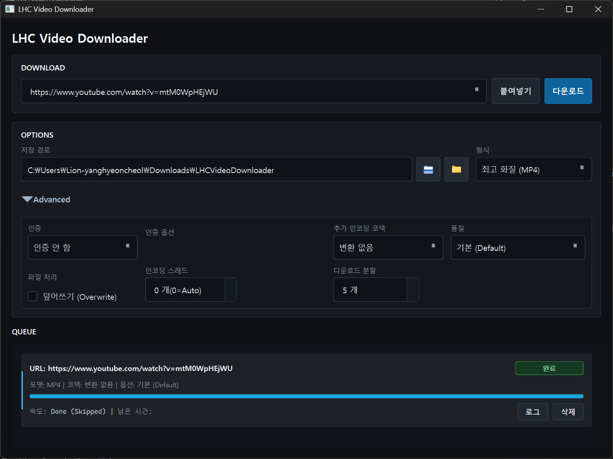

#  LHC Video Downloader

**LHC Video Downloader**는 최신 `yt-dlp`, `FFmpeg`, `Deno`를 기반으로 YouTube를 비롯한 1,000개 이상의 사이트에서 고화질 영상과 오디오를 빠르고 안정적으로 내려받을 수 있는 Windows용 PySide6 데스크탑 앱입니다.



---

## ✨ 주요 기능

### 1. 고속 분할 다운로드 & 안정적인 병합/후처리
- **분할 다운로드**: `yt-dlp`의 동시 조각 다운로드(`-N`, 기본 5개)를 지원해 대용량 4K/8K 영상도 빠르게 내려받습니다.
- **병합 후 잔여 파일 자동 정리**: Windows 탐색기나 백신(Defender)의 일시적 파일 잠금(`WinError 32`)으로 인해 병합 직후 남을 수 있는 중간 스트림 파일(`*.f401.mp4`, `*.f140.m4a` 등)을 재시도 로직으로 안전하게 정리합니다.
- **안전한 작업 취소**: 취소 시 실행 중인 `yt-dlp` 및 하위 `ffmpeg` 프로세스 트리 전체를 종료하고 `.part`, `.part-Frag*`, `.ytdl`, `_encoding*` 임시 파일을 정리합니다.

### 2. 스마트 포맷 선택 & 후처리 인코딩
- **변환 없음(기본 추천)**: 재인코딩 없이 최적 스트림을 바로 내려받습니다. MP4 선택 시 `m4a` 오디오 호환 스트림을 우선 조합하며, WebM 선택 시 사이트 호환성에 따라 안전하게 병합합니다.
- **추가 인코딩 지원**:
  - 코덱: `H264 (CPU / libx264)`, `NVENC H264 (GPU / h264_nvenc)`, `HEVC (H265 / libx265)`, `VP9 (libvpx-vp9)`
  - 프리셋: `기본 (Default)`, `무손실 (Lossless)`, `최소 손실 (High Quality)`, `최대 압축 (Small Size)`
  - 출력 컨테이너(`.mp4` / `.webm` / `.mkv`)에 맞춰 오디오 코덱(`aac` / `libopus` / `copy`)을 자동으로 맞추고, `_encoding` 임시 파일에 인코딩을 완료한 뒤 원자적으로 교체하므로 실패 시에도 원본이 손상되지 않습니다.

### 3. 성인 인증 · 연령 제한 영상 원클릭 로그인 및 자동 재시도
- **시스템 Chrome/Edge 격리 프로필 + CDP 로그인 (권장)**:
  - 현재 사용 중인 브라우저를 닫지 않고, 임시 격리 프로필과 로컬 CDP(`--remote-debugging-port`)로 실제 Chrome/Edge/Brave 창을 열어 Google 로그인 및 성인 인증을 진행합니다.
  - Windows Chrome/Edge의 App-Bound Encryption(`v20`) 영향을 받지 않고 복호화된 쿠키를 추출하며, 저장 직전 `youtube.com/robots.txt`로 이동한 뒤 브라우저를 즉시 닫아 YouTube 백그라운드 쿠키 로테이션으로 인한 조기 만료를 최소화합니다.
- **내장 브라우저(QtWebEngine) 폴백**: Chromium 브라우저가 없는 환경에서도 User-Agent 보정 및 `robots.txt` 추출이 적용된 내장 브라우저 로그인을 사용할 수 있습니다.
- **자동 인증 폴백(`자동 (필요 시 인증 · 권장)`)**:
  - 평소 일반 영상은 쿠키 없이 다운로드하고, 연령 제한(`Sign in to confirm your age`)·봇 확인·멤버십 오류가 발생하면 저장된 쿠키로 자동 재시도합니다.
  - 로그인되어 있지 않거나 쿠키가 만료된 경우 작업 행에 **`로그인 후 재시도`** 버튼이 표시되어 로그인 완료 즉시 해당 작업을 이어서 재시도할 수 있습니다.

### 4. 스마트 바이너리 관리 & 자동 로그 저장
- **앱 시작 시 `yt-dlp` 1회 업데이트**: 매 다운로드마다 업데이트를 확인하지 않고, 앱 실행 시 백그라운드에서 한 번 GitHub 최신 릴리스로 원자적 업데이트를 확인합니다(실패 시 `yt-dlp -U` 폴백).
- **FFmpeg 정상 동작 확인**: `ffmpeg.exe`와 `ffprobe.exe`가 이미 존재하고 정상 실행되면 불필요하게 최신 버전을 다시 다운로드하지 않습니다.
- **자동 로그 저장**: 앱 전체 회전 로그(`app.log`)와 작업별 상세 로그(`logs/tasks/*.log`, 최근 50개 보관)가 자동 저장되며, 작업 로그 창의 **`로그 폴더 열기`** 버튼으로 바로 확인할 수 있습니다.

---

## 📥 설치 및 실행

### 방법 1: 배포판 실행 (일반 사용자)
1. **[GitHub Releases 페이지](https://github.com/CharlieYang0040/lhcVideoDownloader/releases)**에서 최신 배포본(포터블 압축 파일 또는 `LHC_Setup` 설치 파일)을 내려받습니다.
2. 압축을 풀거나 설치한 뒤 **`LHCVideoDownloader.exe`** 를 실행합니다.

### 방법 2: 소스에서 바로 실행 (Windows)
Python 3.11+ 환경에서 저장소를 클론한 뒤 **`run_app.bat`** 을 실행하면 가상환경(`venv`) 생성, 패키지 설치, 누락된 외부 바이너리(`yt-dlp`, `ffmpeg`, `deno`) 준비 후 앱이 자동 실행됩니다.

```bat
run_app.bat
```

---

## 📖 사용 가이드

### 1. 상단 상태 바 & 다운로드 입력 (`Download`)
- **상단 헤더**: 현재 **YouTube 로그인 상태**(`로그인됨` / `쿠키 만료됨` / `로그인 안 됨`), **`YouTube 로그인`** 버튼, **앱 시작 시 `yt-dlp` 버전/업데이트 상태**가 표시됩니다.
- **URL 입력 / 붙여넣기 / 다운로드**: 주소 입력창(최근 URL 20개 기록 지원)에 영상이나 재생목록 URL을 넣고 **`다운로드`** 를 누르면 `Queue`에 추가되어 즉시 시작됩니다.

### 2. 기본 옵션 (`Options`)
- **저장 경로**: 내려받을 폴더를 지정합니다. 우측 아이콘으로 폴더를 선택하거나 탐색기에서 바로 열 수 있습니다.
- **형식**:
  - `최고 화질 (MP4)` / `최고 화질 (MKV)` / `최고 화질 (WebM)`
  - `오디오만 (MP3)` / `오디오만 (WAV)`

### 3. 고급 옵션 (`Advanced`)
- **인증**:
  - `자동 (필요 시 인증 · 권장)` *(기본값)*: 일반 영상은 비인증, 성인 인증/봇 차단 오류 시 저장된 쿠키로 자동 재시도
  - `저장된 쿠키 항상 사용`: 모든 요청에 저장된 YouTube 쿠키를 포함
  - `Firefox (자동)`: 설치된 Firefox 프로필의 쿠키를 직접 사용 (`--cookies-from-browser firefox`)
  - `파일 (Cookies.txt)`: Netscape 형식의 `cookies.txt` 파일을 직접 지정
  - `인증 안 함`: 쿠키를 전혀 사용하지 않음
- **인증 옵션**: `YouTube 로그인`, `로그아웃`(저장된 쿠키 삭제), 현재 쿠키 상태 확인
- **추가 인코딩 코덱 / 품질**: 재인코딩 코덱과 프리셋 선택 (`변환 없음` 권장)
- **파일 처리**: `덮어쓰기 (Overwrite)` 체크 시 기존 파일을 덮어쓰고, 해제 시 건너뜀
- **인코딩 스레드**: FFmpeg 스레드 개수 (`0` = 자동)
- **다운로드 분할**: 동시 다운로드 조각 수 (`1~32`, 기본 `5`)

### 4. 작업 목록 (`Queue`) & 성인 인증 영상 받기
- 각 작업 카드에서 진행률, 속도, 남은 시간, 상태 배지(`대기` / `진행 중` / `병합 중` / `인코딩 중` / `인증 재시도` / `인증 필요` / `완료` / `오류`)를 확인할 수 있습니다.
- **`로그`**: 작업별 실시간 출력과 FFmpeg 오류 로그를 확인·복사하고 **`로그 폴더 열기`** 로 저장된 로그 폴더를 엽니다.
- 성인 인증 영상이 걸렸을 때 **`로그인 후 재시도`** 버튼이 뜨면 클릭해 로그인을 완료하는 즉시 해당 작업이 자동으로 다시 시작됩니다.

---

## 📁 사용자 데이터 및 로그 경로

설정, 로그인 쿠키, 로그는 프로그램 폴더가 아닌 Windows 사용자 데이터 폴더에 저장됩니다. (환경 변수 `LHCVD_USER_DATA_DIR`로 경로 재정의 가능)

```text
%LOCALAPPDATA%\LHCinema\LHCVideoDownloader\
├── config.json                 # 마지막 저장 경로, 형식, 인증/코덱 설정, URL 기록
├── cookies\
│   └── auth_cookies.txt        # Netscape 형식 YouTube 로그인 쿠키
└── logs\
    ├── app.log                 # 앱 전체 로그 (최대 5MB × 5개 회전 보관)
    └── tasks\
        └── YYYYMMDD_HHMMSS_*.log  # 작업별 상세 로그 (최근 50개 보관)
```

---

## 🛠️ 개발자 설정 및 빌드

### 1. 의존성 설치 및 바이너리 준비
런타임 의존성(`requirements.txt`)에는 경량화된 `PySide6-Essentials`만 포함되며, 배포 빌드용 `pyinstaller`는 `requirements-build.txt`로 분리되어 있습니다.

```bash
python -m venv venv
venv\Scripts\activate

# 일반 실행용:
pip install -r requirements.txt
# 배포 빌드(PyInstaller) 포함 시:
pip install -r requirements-build.txt

# libs/yt-dlp, libs/ffmpeg, libs/deno 자동 확인 및 누락분 다운로드
python setup_binaries.py
# yt-dlp 업데이트를 건너뛰고 누락 바이너리만 확인하려면:
python setup_binaries.py --no-ytdlp-update
```

> `setup_binaries.py`는 `ffmpeg.exe`와 `ffprobe.exe`가 정상 실행되면 다시 받지 않으며, `yt-dlp.exe`와 `deno.exe`가 없을 때 최신 릴리스를 내려받습니다.

예상 프로젝트 구조:

```text
lhcVideoDownloader/
├── libs/
│   ├── deno/deno.exe
│   ├── ffmpeg/ffmpeg.exe, ffprobe.exe
│   └── yt-dlp/yt-dlp.exe
├── resources/
├── src/
│   ├── core/
│   │   ├── auth_manager.py     # CDP 원클릭 로그인 및 Netscape 쿠키 관리
│   │   └── downloader.py       # yt-dlp/FFmpeg 실행, 시작 업데이트, 로그 저장
│   ├── ui/
│   │   ├── login_dialog.py     # 외부 브라우저 CDP + QtWebEngine 폴백 로그인 창
│   │   ├── main_window.py      # 메인 UI 및 설정/작업 관리
│   │   ├── task_widget.py      # 작업 행 UI 및 로그 다이얼로그
│   │   └── theme.py            # 다크 테마 스타일시트
│   ├── utils/
│   │   ├── config.py           # JSON 설정 관리
│   │   └── helpers.py          # 경로, 런타임 탐색, 프로세스 트리 종료 헬퍼
│   └── main.py                 # 앱 진입점 및 회전 로깅 설정
├── LHCVideoDownloader.spec     # PyInstaller 빌드 스펙
├── LHC_Setup_Script.iss        # Inno Setup 설치 프로그램 스크립트
├── run_app.bat
└── setup_binaries.py
```

### 2. 실행 및 패키징 / 자동 릴리즈
```bash
# 소스 실행 (디버그 콘솔 로그 포함 시 --debug)
python -m src.main --debug

# PyInstaller 포터블 빌드 (dist/LHCVideoDownloader 생성)
pyinstaller --clean --noconfirm LHCVideoDownloader.spec
```

- `v*` 태그(예: `v2.0.0`)를 푸시하면 `.github/workflows/release.yml` 워크플로우가 Windows 포터블 압축 파일(`LHCVideoDownloader_v2.0.0.zip`)을 자동 빌드하여 GitHub Releases에 게시합니다.
- PyInstaller 빌드 후 `LHC_Setup_Script.iss`를 Inno Setup으로 컴파일하면 `installer_output/LHC_Setup.exe` 설치 파일이 생성됩니다.

---

## ⚖️ 라이선스 및 주의사항

이 프로그램은 오픈 소스 프로젝트입니다. 다운로드한 콘텐츠의 저작권 및 각 플랫폼 이용약관 준수에 대한 책임은 전적으로 사용자에게 있으며, 개인적인 용도로만 사용하시기 바랍니다.
